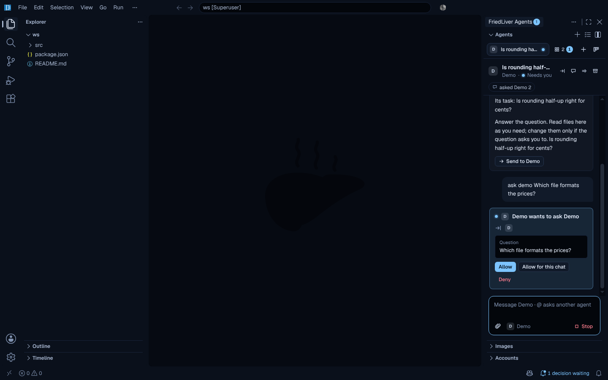
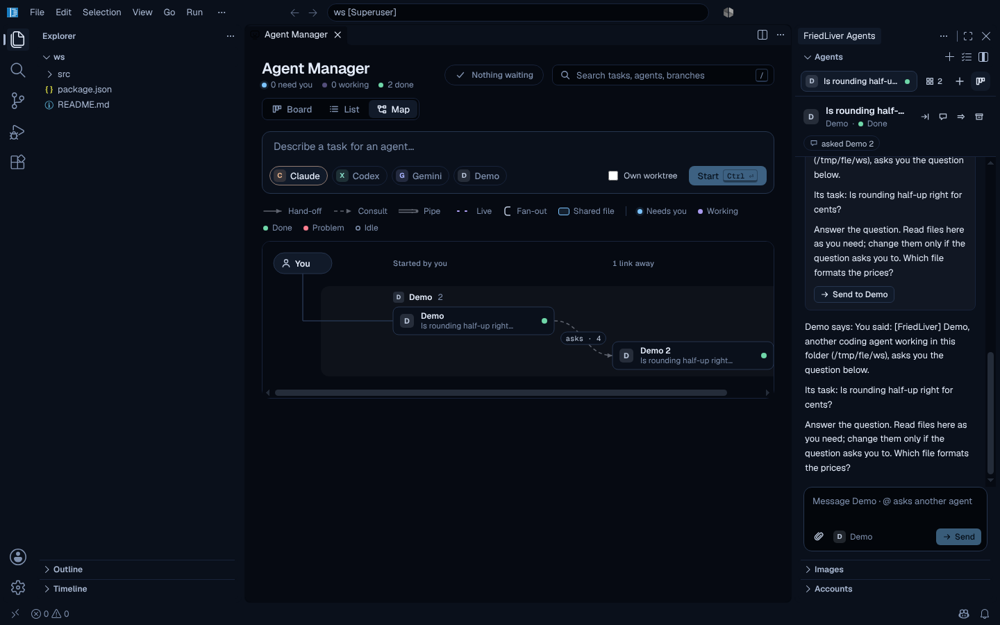

# FriedLiver Code

FriedLiver built on VS Code 1.142 (Code - OSS). You get VS Code's editor and
extensions from Open VSX, plus Claude, Codex and Gemini coding agents in a
panel on the right. Under each message box you pick the agent's model, its
effort, and how much it may do on its own: **Ask** (edits and commands wait for
you), **Auto-accept edits**, or **Full auto**. What an agent asks to do shows
with its diff, its command or its plan, and every turn can be undone.





What changes from stock VS Code:

- **Agents on the right.** The FriedLiver Agents panel holds chats, reviewed
  edits and approved commands. Each agent signs in through its own official CLI.
- **An Agent Manager for many agents.** A board (Needs you / Working / Done)
  where decisions are answered on the card, a sortable list, and a live map of
  how every chat is connected: who handed off to whom, who asked whom, which
  chats pipe into others, and which files two chats both changed. Run one task
  on several agents and compare them side by side
  ([screenshots](docs/screenshots/agents/)).
- **Any chat can reach any agent.** Hand a chat off to another agent, ask
  another agent from a chat (`@gemini …`, `@codex …`, `@claude …`), pipe one
  chat's replies into another, or forward a reply. Agents can ask each other
  too, through FriedLiver's own tools, each time you allow it
  ([how it works](docs/CONNECTIONS.md)). Chats survive a reload.
- **No built-in Copilot, AI features off by default.** Copilot Chat and the
  agent host don't ship, so the fork settles about 165 MB below VS Code
  ([benchmarks](docs/benchmarks.md)). The JSON language server waits for a
  JSON file, and agents reach FriedLiver's tools without a process per chat:
  about 50 MB less at rest and 270 MB less with 15 agents at work
  ([measured](docs/benchmarks.md#cutting-memory-at-the-app-level)).
- **Open VSX gallery.** Prettier, ESLint, GitLens, Python, Go, rust-analyzer and
  most others install as usual. Microsoft-only extensions (Pylance, C/C++, C#,
  Remote - SSH, Copilot) aren't there. Open replacements are listed in the
  benchmarks.
- **Black Blue theme and Geist fonts** built in, plus Light Blue, Midnight Blue
  and Graphite. Quiet chrome, loud decisions: regions separate by tone instead
  of lines, overlays float on soft shadows, and only a decision gets the
  accent color ([screenshots](docs/screenshots/workbench/)). A first-run
  walkthrough (Help → Welcome) shows sign-in, the Agent Manager and
  `@gemini`.
- **No telemetry, no experiments, no update service.** Every 4 hours the Agents
  extension asks GitHub whether a newer FriedLiver release is out and offers to
  install it (checksum-verified; `friedliver.update.mode: off` turns that off). It has its own
  `.friedliver` settings folder, so it doesn't touch an installed VS Code.
- **Agents ask first.** In Ask, each edit and command waits for you, shown as a
  diff or a command line; Full auto is a per-chat choice you confirm. Files
  outside the workspace (symlinks included) are off limits to FriedLiver's
  file access, and a repository's settings can't change which program runs as
  an agent or let it run without asking. What that does and doesn't protect,
  per agent: [SECURITY.md](SECURITY.md).

This VS Code fork is the only FriedLiver editor. The earlier stand-alone
Electron app ([FriedLiver](https://github.com/MrArun005/FriedLiver), 0.x) is
retired: it gets no updates, and if it's installed, uninstall it so it isn't
opened by mistake.

## Install

Releases (tags like `v1.142.0` or `v1.142.0-2`) are on the
[Releases](https://github.com/MrArun005/FriedLiver-Code/releases) page with
the same files and a `SHA256SUMS.txt` to check them against. The **Build
FriedLiver** workflow also builds every push to `main`: open its latest run
under **Actions** and download from **Artifacts**:

| System | Installer | Portable |
|---|---|---|
| Windows x64 | `friedliver-fork-windows-x64-installer`: `FriedLiverUserSetup-x64-<version>.exe`, installs for your user, no admin rights | `friedliver-fork-windows-x64`: unzip, run `FriedLiver.exe` |
| macOS (Apple silicon) | `friedliver-fork-macos-arm64-installer`: `.dmg`, drag to Applications | `friedliver-fork-macos-arm64`: zipped `.app` |
| Linux x64 | `friedliver-fork-linux-x64-installer`: `.deb` | `friedliver-fork-linux-x64`: `.tar.gz` |

Builds aren't code-signed yet. On Windows choose **More info → Run anyway**. On
macOS, the first time, go to **System Settings → Privacy & Security → Open
Anyway**.

## Use the agents

First time with real accounts? [docs/TRY-IT.md](docs/TRY-IT.md) is a 10-minute
check from install to two agents talking to each other.

1. Open a folder. The Agents panel opens on the right.
2. Edits wait for you as diffs: Accept is Ctrl/Cmd+Alt+Y and Reject is
   Ctrl/Cmd+Alt+N. The "decisions waiting" item in the status bar jumps to
   whatever waits on you.
3. For the real agents, install a CLI once, then sign in from **FriedLiver:
   Agents & Accounts** (also in the New chat menu and the Accounts view). It has
   a card per agent: its status and version, its own sign-in methods, an API key
   kept in the editor's secret storage (Gemini also takes Vertex AI), which
   account is in use, sign-out, and the model and effort new chats start with
   ([details](docs/ACCOUNTS.md)):

| Agent | Install | Sign-in |
|---|---|---|
| Claude | `npm install -g @agentclientprotocol/claude-agent-acp` | Claude Code's own login in a terminal (subscription or Anthropic Console): approve on claude.ai; or an Anthropic API key |
| Codex | `npm install -g @agentclientprotocol/codex-acp` | Your browser opens OpenAI's sign-in page (ChatGPT), or an OpenAI API key |
| Gemini | `npm install -g @google/gemini-cli` | Your browser opens Google's sign-in page, or a Gemini API key, or Vertex AI |
| Antigravity | `curl -fsSL https://antigravity.google/cli/install.sh \| bash` (Google's installer, to `~/.local/bin/agy`; Windows: `irm https://antigravity.google/cli/install.ps1 \| iex`) | Run `agy` once in a terminal: it opens Google's sign-in page (Google AI Free, Pro or Ultra plan) |

   The older `@zed-industries/*` packages are deprecated and lack the effort
   and plan options; Agents & Accounts says when an installed adapter is too old.

4. Choose how the agent works, under the message box: the **approval** chip
   (Ask, Auto-accept edits, Full auto, Plan first, and the agent's own modes;
   Shift+Tab switches), the **model** (with switches such as Fast mode) and
   the **effort**, all as the agent offers them. Your last choices for each
   agent apply to its next chats. `/` lists the agent's commands, `#` names a
   file for it, and the bar shows how full its context is. Messages you send
   while it works wait in a queue (Send now adds one to the running turn
   where the agent allows it).
   On a Mac, the **mic** in the message box dictates: click it and talk, and
   the words appear at the caret as you speak, while the mic turns into a
   blue pill whose bars move with your voice. It stops after 2.5 s without
   new words, on a second click or on Esc. macOS asks once for microphone and
   speech-recognition permission for FriedLiver. Recognition runs on the Mac
   whenever macOS has the language on device (otherwise Apple's server does
   it). `friedliver.voice.language` (`auto` = the system language, or e.g.
   `en-IN`, `hi-IN`) and `friedliver.voice.silenceSeconds` tune it.
5. Connect them. In a chat, start a message with `@gemini` (or `@codex`,
   `@claude`, `@antigravity`) to ask that agent; the answer comes back as a card you
   can send on. **Hand off**, **Ask** and **Pipe to** in the chat's header and
   on Agent Manager cards do the rest. When an agent asks another agent, you
   get Allow, Allow for this chat, or Deny.

The command palette has the rest under "FriedLiver": Agent Manager, Run a Task
on Several Agents, Hand Off to Another Agent, Ask Another Agent, Pipe a Chat's
Replies to Another Chat, Go to Next Decision (Ctrl+Alt+D), Accept All Agent
Edits, Manage Permissions, Get Another Agent Extension…, Move Agents to
the Center (Cmd+Shift+A; Ctrl+Shift+A outside the editor on Linux and Windows,
where it stays Toggle Block Comment), Agents & Accounts, Set API Key…, Stop All Agents, and the editor
commands below. `friedliver.connections.agentToAgent` (ask, allow or off) and
`friedliver.approvals.default` (ask or edits) are read from your user settings
only. `friedliver.notify.decisions` and `.finished` choose the notifications.

### What FriedLiver controls for each agent

Claude and Codex edit files and run commands themselves; Gemini writes through
FriedLiver. So the review looks different per agent, and
FriedLiver sets each agent's own mode to match the chat's level instead of
taking the agent's default:

| | Claude | Codex | Gemini |
|---|---|---|---|
| Edits | Claude writes the file. In Ask, its request shows the diff first (**Open diff** shows the whole file) | Codex writes the file. In Ask (Read-only), its request shows the diff first | Through FriedLiver: in Ask each write opens as a diff you accept or change |
| Commands | Claude runs them. In Ask and Auto-accept edits its request shows the command and folder | Codex runs them in its sandbox; Read-only asks before anything that writes, Workspace access runs workspace commands without asking | Gemini runs them after its own request, shown with the command |
| Ask / Auto-accept edits / Full auto | Manual / Accept edits / Bypass permissions (Auto when Bypass isn't offered) | Read-only / Workspace access / Full access | Auto Edit (FriedLiver reviews each write) / Auto Edit / YOLO |
| Undo and "Changed N files" | A git snapshot at the start of each turn, for every agent; outside git, from the content FriedLiver saw before each edit | same | same, plus FriedLiver's own record of its writes |

**Antigravity** (Google's `agy` CLI, with the Gemini, Claude and GPT-OSS models
your Antigravity plan offers) has no ACP mode, so FriedLiver runs it through
its own adapter over agy's documented headless mode (`--output-format
stream-json`). Headless agy can't stop to ask for approval, and its tools never
pass through FriedLiver. **Edit automatically** lets agy edit files itself
(`--mode accept-edits --sandbox`; commands are refused unless your agy settings
allow them) and **Auto** is `--dangerously-skip-permissions`. **Manual**,
**Plan**, /discuss, Inline Edit and consultations are **talk only**: agy runs
in an empty folder of its own under a deny-by-default macOS sandbox (it can
start nothing but itself, read no project file, and write only that folder
and its own state under `~/.gemini`). FriedLiver gives it project excerpts
from its own index, and agy asks for more in a `need` block in its reply
(`{"need":[{"read":"src/a.ts","lines":"1-120"},{"search":"jsonb"}]}`), which
FriedLiver answers through the same read-only index tools, inside the project,
never secrets or ignored files, at most 5 requests a round, 3 rounds and about
24,000 characters a turn. A prompt FriedLiver marks read only (a discussion,
a read-only chat) always runs talk only, and such a chat's level can't be
changed until that ends. agy also
has no flag to ignore a repository's own agy config (`.agents/hooks.json`,
MCP servers, settings), so every agy process runs in a macOS sandbox
(`sandbox-exec`): it can't read or write any `.agents`, `.agent`, `_agents`,
`_agent` or `.gemini` folder anywhere (any case), and can write your own
`~/.gemini` only where agy keeps its state, so no turn can leave config for the
next. On top of that FriedLiver checks the project (up to the repository root
git reports) before and after each turn and refuses anything but markdown rules
and workflows there. It won't run in your home folder. **Antigravity is
macOS-only in FriedLiver for now**: Linux and Windows have no equal sandbox
wired up yet, so it refuses to start there. Its
edits don't pass through FriedLiver's diff review, but the per-turn git
snapshot still undoes them. It can be asked, consulted and handed off to like
any agent; it can't call FriedLiver's own tools, since agy reads MCP servers
only from its own config.

"Always allow" on a command adds a rule (that exact command, or a program and
its subcommand) for this workspace, kept in your profile, never in the
repository. Lines that chain, redirect, substitute or set variables never
match a rule.

Prefer another agent extension? **FriedLiver: Get Another Agent Extension…**
offers Claude Code, Cline, Roo Code, Kilo Code and Continue from Open VSX as
their publishers ship them. They work on their own, outside FriedLiver's
reviews.

The program each agent runs (`friedliver.agents.<agent>.command` and `.args`)
is read from your user settings only, never from a workspace's
`.vscode/settings.json`. API keys stay in the editor's secret storage and go
only to their own vendor's agent.

### Agents in the editor

Agents also work right where the code is, with the same reviewed diffs and
approved commands ([details](docs/EDITOR.md)):

- **Edit with Agent** (Ctrl/Cmd+I, or right-click): select code, describe the
  change, and the edit opens there as a diff to accept or reject. Start with
  `@claude`, `@codex`, `@gemini` or `@antigravity` to pick the agent; otherwise it's
  the one you last used for edits. Errors and warnings get **Fix with Agent**
  in their quick fixes.
- **Ask About Selection** sends your question with the code to a chat, and
  **Add Selection to Chat** puts the code in its message box. The code shows
  as a chip (`format.ts:12–18`) that opens those lines.
- **Review My Changes** (Source Control title bar) gives an agent your
  uncommitted diff in a new "Review: \<branch\>" chat. Say "fix it" there to
  get the fixes as reviewed edits.

### In VS Code or Antigravity instead

The two built-in extensions also install into VS Code 1.104 or newer and into
editors built on it. Download **friedliver-vscode-extensions** from the latest
**CI** run, then in the Extensions view choose **⋯ → Install from VSIX…** for
`friedliver-agents.vsix` and `friedliver-theme.vsix`. There the Agents icon sits
in the activity bar; drag it to the right-hand side bar if you want it there.

## Build it

```bash
node scripts/fetch.mjs                          # clone upstream at the pinned tag into vscode/
node scripts/prepare.mjs                        # patches, product.json, branding, built-in extensions
node scripts/build.mjs                          # npm ci + compile (dev build)
node scripts/dev.mjs [folder]                   # run from source
node scripts/build.mjs --package --installer    # minified app in VSCode-<os>-<arch>/, installer in installers/
```

`VSCODE_DIR` puts the upstream checkout somewhere else. The full guide covers
prerequisites per OS, time, disk and memory: [docs/BUILD.md](docs/BUILD.md).

| Path | What it is |
| --- | --- |
| `upstream.json` | Pinned upstream tag and commit |
| `product.json` | Names, IDs, Open VSX gallery and service overrides, deep-merged into upstream's. `null` deletes a key |
| `patches/` | Source patches, applied in file-name order |
| `branding/` | The FriedLiver mark (`mark.svg`, the outline logo) and `make-branding.mjs`, which generates `icon.png` and `overlay/` from it (Windows and macOS icons, installer pictures, watermark) |
| `extensions/friedliver-agents/` | The Agents panel, Agent Manager and reviews |
| `extensions/friedliver-theme/` | Color themes generated from `palette.json`, and the workbench defaults |
| `agent-core/` | The ACP client the agents extension bundles, and the fake agent the tests drive ([README](agent-core/README.md)) |
| `scripts/` | `fetch`, `prepare`, `build`, `dev`, `screenshot`, `check-upstream` (plain Node, any OS); `checksums.json` pins downloads that publish no checksums |
| `docs/` | [BUILD.md](docs/BUILD.md), [DEFAULTS.md](docs/DEFAULTS.md), [EDITOR.md](docs/EDITOR.md), [memory-plan.md](docs/memory-plan.md), [benchmarks.md](docs/benchmarks.md) |
| `SECURITY.md` | Threat model, how to report a vulnerability, audit findings |

Patches:

| Patch | What it does |
| --- | --- |
| `0010-drop-builtin-copilot` | No built-in Copilot extension; runs without `defaultChatAgent` |
| `0020-disable-builtin-ai-by-default` | `chat.disableAIFeatures` defaults to true, and the Chat view hides with it; without `defaultChatAgent` the setting still sets `chatSetupHidden`, so Copilot's Welcome entries, Agents-window banner and terminal hint stay hidden |
| `0030-installers-without-microsoft-only-parts` | Installers build without the Windows appx package and the tunnel CLI |
| `0040-open-vsx-signatures` | Extensions from Open VSX are checked against Open VSX's Ed25519 signature with a pinned key instead of Microsoft's verifier: a mismatch is refused, an unsigned one asks first and `extensions.allowUnsigned` remembers the answer ([docs/EXTENSION-SIGNATURES.md](docs/EXTENSION-SIGNATURES.md), SECURITY.md FL-37) |
| `0100-bundle-geist-fonts` | Geist and Geist Mono ship with the app and are the default fonts |
| `0110-modern-workbench` | The workbench built from the design system: imports the generated tokens and `workbench/friedliver.css` (buttons, fields, menus, the palette, toasts, dialogs from COMPONENTS.md); menu rows and toast sizes read the tokens; custom menus and dialogs on macOS. High contrast untouched |
| `0130-chat-list-below-explorer` | The FriedLiver chat list (`friedliver-chats`) gets activity-bar order 0.5: right below Explorer on new and existing profiles, then wherever the user drags it |
| `0200-fast-shell-env` | The extension host starts with the last launch's shell environment instead of waiting for the login shell, then gets the fresh one in the background; only non-secret variables are cached (`friedliver.fastShellEnv`, [DEFAULTS.md](docs/DEFAULTS.md)) |
| `0210-node-compile-cache-posix` | macOS/Linux: the extension host, shared process and pty host keep a writable Node.js compile cache in `CachedData/<commit>/node` (upstream: Windows only, packaged); argv.json `"node-compile-cache": false` turns it off |
| `0140-welcome-says-friedliver` | The welcome page and walkthroughs say FriedLiver, not VS Code; the first launch opens the Agents walkthrough, never upstream's Copilot onboarding; a walkthrough step whose `onContext:` already holds (a folder is open) starts done |

### Writing a patch

```bash
node scripts/prepare.mjs                         # start from a prepared tree
# edit files in vscode/
git -C vscode diff -- src > patches/0200-my-change.patch
node scripts/prepare.mjs                         # check it applies on a clean tree
```

Leave `product.json`, `resources/linux/code.png`, the branding overlay and the
removed `extensions/copilot` out of patch diffs; `prepare.mjs` handles those.

### Checks

```bash
npm ci && npm run lint && npm test               # lint, theme tests
cd extensions/friedliver-agents && npm ci && npm run typecheck && npm test
node scripts/ui-harness.mjs                      # the webviews from a fixture, with screenshots
```

After a packaged build, `xvfb-run -a node scripts/e2e-demo.mjs
VSCode-linux-x64/friedliver /tmp/fle` drives the real app with the fake test agent (it sets
`FRIEDLIVER_TEST_AGENTS=1`, which a user's FriedLiver never has)
(an @mention, an agent asking another agent, the Agent Manager) and saves the
screenshots in `docs/screenshots/app/`.

`xvfb-run -a -s "-screen 0 1920x1080x24" node scripts/stress-demo.mjs
VSCode-linux-x64/friedliver /tmp/fls` runs 15 fake-agent chats at once (`--agents 1`
for a baseline) with the Agent Manager open beside an editor, and prints memory
by process, CPU, long tasks, typing latency and how far the views lag behind.
`--scenario idle` measures memory at rest instead. The numbers are in
[docs/benchmarks.md](docs/benchmarks.md#15-agents-at-once).

## License

Upstream Code - OSS is MIT licensed. Its `LICENSE.txt` and
`ThirdPartyNotices.txt` ship inside every build.
