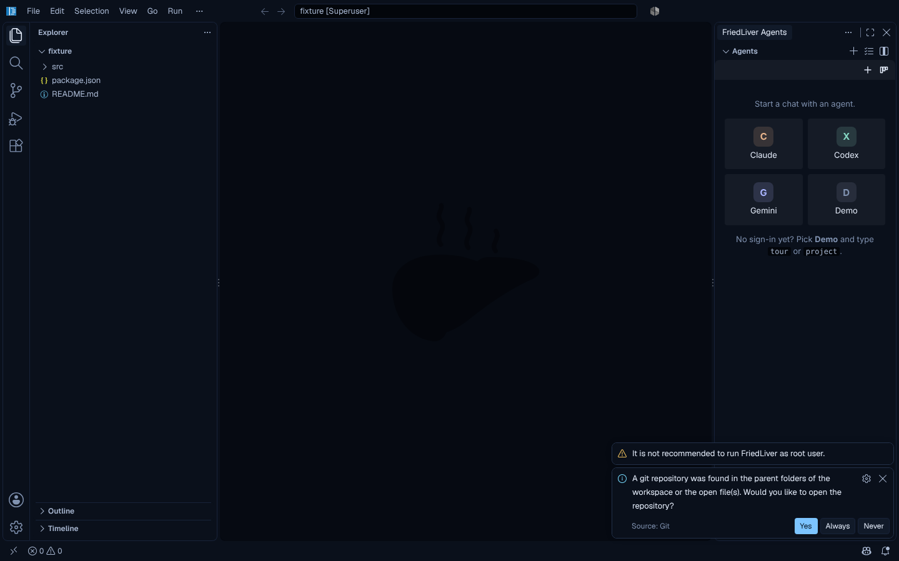

# FriedLiver Code

FriedLiver built on VS Code 1.142 (Code - OSS). You get VS Code's editor and
extensions from Open VSX, plus Claude, GPT (Codex) and Gemini coding agents in a
panel on the right. Every file an agent wants to write opens as a diff you
accept or reject, and every command waits for your approval.



What changes from stock VS Code:

- **Agents on the right.** The FriedLiver Agents panel holds chats, the Agent
  Manager board (Needs you / Working / Done), reviewed edits and approved commands.
  Each agent signs in through its own official CLI.
- **No built-in Copilot, AI features off by default.** Copilot Chat and the
  agent host don't ship, so the fork settles about 165 MB below VS Code
  ([benchmarks](docs/benchmarks.md)).
- **Open VSX gallery.** Prettier, ESLint, GitLens, Python, Go, rust-analyzer and
  most others install as usual. Microsoft-only extensions (Pylance, C/C++, C#,
  Remote - SSH, Copilot) aren't there. Open replacements are listed in the
  benchmarks.
- **Black Blue theme and Geist fonts** built in, plus Light Blue, Midnight Blue
  and Graphite.
- **No telemetry, no experiments, no update service.** Once a week the Agents
  extension asks GitHub whether a newer FriedLiver release is out and tells
  you (`friedliver.updates.check` turns that off). It has its own
  `.friedliver` settings folder, so it doesn't touch an installed VS Code.
- **Agents ask first.** Writes are reviewed, commands approved, files outside
  the workspace (symlinks included) are off limits, and a repository's
  settings can't change which program runs as an agent. What that does and
  doesn't protect: [SECURITY.md](SECURITY.md).

The Electron app, a separate and lighter editor (about 370 MB against about
840 MB here), lives in [FriedLiver](https://github.com/MrArun005/FriedLiver).

## Install

Releases (tags like `v1.142.0` or `v1.142.0-2`) are on the
[Releases](https://github.com/MrArun005/FriedLiver-Code/releases) page with
the same files and a `SHA256SUMS.txt` to check them against. The **Build
FriedLiver** workflow also builds every push to `main`: open its latest run
under **Actions** and download from **Artifacts**:

| System | Installer | Portable |
|---|---|---|
| Windows x64 | `friedliver-fork-windows-x64-installer`: `FriedLiverUserSetup-x64-<version>.exe`, installs for your user, no admin rights | `friedliver-fork-windows-x64`: unzip, run `FriedLiver.exe` |
| macOS (Apple silicon) | `friedliver-fork-macos-arm64-installer`: `.dmg`, drag to Applications | `friedliver-fork-macos-arm64`: zipped `.app` |
| Linux x64 | `friedliver-fork-linux-x64-installer`: `.deb` | `friedliver-fork-linux-x64`: `.tar.gz` |

Builds aren't code-signed yet. On Windows choose **More info → Run anyway**. On
macOS, the first time, go to **System Settings → Privacy & Security → Open
Anyway**.

## Use the agents

1. Open a folder. The Agents panel opens on the right.
2. Pick **Demo** and type `tour` to try it offline: a plan, an edit you review as
   a diff, a command you approve, an image. Accept is Ctrl/Cmd+Alt+Y and Reject
   is Ctrl/Cmd+Alt+N. The "decisions waiting" item in the status bar jumps to
   whatever waits on you.
3. For the real agents, install a CLI once, then sign in from **Accounts** in
   the same panel:

| Agent | Install | Sign-in |
|---|---|---|
| Claude | `npm install -g @zed-industries/claude-agent-acp` | Claude Code's own login in a terminal: `/login`, approve on claude.ai, `/exit` |
| GPT (Codex) | `npm install -g @zed-industries/codex-acp` | Your browser opens OpenAI's sign-in page |
| Gemini | `npm install -g @google/gemini-cli` | Your browser opens Google's sign-in page |

The command palette has the rest under "FriedLiver": Agent Manager (Tasks), Move
Agents to the Center (Ctrl/Cmd+Shift+A), Set API Key, Stop All Agents.

The program each agent runs (`friedliver.agents.<agent>.command` and `.args`)
is read from your user settings only, never from a workspace's
`.vscode/settings.json`. API keys stay in the editor's secret storage and go
only to their own vendor's agent.

### In VS Code or Antigravity instead

The two built-in extensions also install into VS Code 1.104 or newer and into
editors built on it. Download **friedliver-vscode-extensions** from the latest
**CI** run, then in the Extensions view choose **⋯ → Install from VSIX…** for
`friedliver-agents.vsix` and `friedliver-theme.vsix`. There the Agents icon sits
in the activity bar; drag it to the right-hand side bar if you want it there.

## Build it

```bash
node scripts/fetch.mjs                          # clone upstream at the pinned tag into vscode/
node scripts/prepare.mjs                        # patches, product.json, branding, built-in extensions
node scripts/build.mjs                          # npm ci + compile (dev build)
node scripts/dev.mjs [folder]                   # run from source
node scripts/build.mjs --package --installer    # minified app in VSCode-<os>-<arch>/, installer in installers/
```

`VSCODE_DIR` puts the upstream checkout somewhere else. The full guide covers
prerequisites per OS, time, disk and memory: [docs/BUILD.md](docs/BUILD.md).

| Path | What it is |
| --- | --- |
| `upstream.json` | Pinned upstream tag and commit |
| `product.json` | Names, IDs, Open VSX gallery and service overrides, deep-merged into upstream's. `null` deletes a key |
| `patches/` | Source patches, applied in file-name order |
| `branding/` | The roasted liver icon and artwork, and `make-branding.py`, which generates `overlay/` (Windows and macOS icons, installer pictures, watermark) |
| `extensions/friedliver-agents/` | The Agents panel, Agent Manager and reviews |
| `extensions/friedliver-theme/` | Color themes generated from `palette.json`, and the workbench defaults |
| `agent-core/` | The ACP client the agents extension bundles, and the offline Demo agent ([README](agent-core/README.md)) |
| `scripts/` | `fetch`, `prepare`, `build`, `dev`, `screenshot`, `check-upstream` (plain Node, any OS); `checksums.json` pins downloads that publish no checksums |
| `docs/` | [BUILD.md](docs/BUILD.md), [DEFAULTS.md](docs/DEFAULTS.md), [memory-plan.md](docs/memory-plan.md), [benchmarks.md](docs/benchmarks.md) |
| `SECURITY.md` | Threat model, how to report a vulnerability, audit findings |

Patches:

| Patch | What it does |
| --- | --- |
| `0010-drop-builtin-copilot` | No built-in Copilot extension; runs without `defaultChatAgent` |
| `0020-disable-builtin-ai-by-default` | `chat.disableAIFeatures` defaults to true, and the Chat view hides with it |
| `0030-installers-without-microsoft-only-parts` | Installers build without the Windows appx package and the tunnel CLI |
| `0040-extensions-without-vsce-sign` | Open VSX installs work without Microsoft's signature-check binary (signature checks are off; see [SECURITY.md](SECURITY.md), FL-18) |
| `0100-bundle-geist-fonts` | Geist and Geist Mono ship with the app and are the default fonts |

### Writing a patch

```bash
node scripts/prepare.mjs                         # start from a prepared tree
# edit files in vscode/
git -C vscode diff -- src > patches/0200-my-change.patch
node scripts/prepare.mjs                         # check it applies on a clean tree
```

Leave `product.json`, `resources/linux/code.png`, the branding overlay and the
removed `extensions/copilot` out of patch diffs; `prepare.mjs` handles those.

### Checks

```bash
npm ci && npm run lint && npm test               # lint, theme tests
cd extensions/friedliver-agents && npm ci && npm run typecheck && npm test
```

## License

Upstream Code - OSS is MIT licensed. Its `LICENSE.txt` and
`ThirdPartyNotices.txt` ship inside every build.
