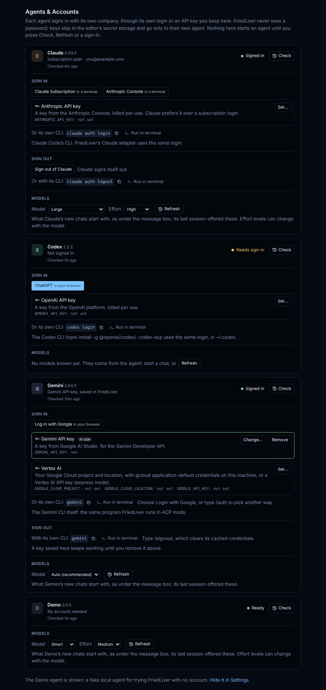

# Agents & Accounts

**FriedLiver: Agents & Accounts** opens a page with one card per agent. Open it
from the command palette, the title of the **Accounts** view, the welcome
walkthrough, **Agents & Accounts…** in the chat's New chat menu, or **Sign in
to <Agent>** on a chat that failed because the agent needs a sign-in (that opens
the page on the agent's card).



(Screenshot from before the Beacon redesign; the cards are the same, the theme
is now FriedLiver Dark.)

## What a card shows

- **Status**: Not checked, Not installed, Needs sign-in, Signed in or Problem,
  the adapter's version, and how long ago it was learned. The same status shows
  as a small dot next to the agent in the New chat menu, Hand off, Ask and the
  Agent Manager's new task.
- **Which way it signs in**: the account the agent reports (Claude's and
  Codex's adapters send `_auth/status_update` with the plan, email or key
  source), else the key saved in FriedLiver, a key variable already in the
  editor's environment, or the sign-in method you last used from FriedLiver.
- **Install** with Copy and Run in terminal, when the agent isn't installed.
- **Sign in**: the agent's own ACP sign-in methods (a browser login through ACP
  `authenticate`, or its terminal login), an API key, and its own CLI's login.
- **Sign out**: the agent's own sign-out (ACP `logout`) when it offers one, and
  its CLI's sign-out line. FriedLiver never deletes a CLI's credential files.
- **Models**: the model and effort the agent's last session offered, and which
  ones its new chats start with. These are the same remembered choices the
  chips under the message box use, so the two always agree.

Nothing on the page starts an agent by itself. **Check** and **Refresh** start
it and open a session that is closed again at once (no model call); a sign-in or
sign-out checks afterwards. Every chat session also updates the card: a session
that starts means signed in, and a chat that fails for want of a sign-in means
needs sign-in. What was learned is kept in the editor's global storage
(`friedliver.accounts`), never a key.

## Per agent

Antigravity is listed first. It runs on macOS only for now, and because agy
can't stop to ask, its Manual, Plan and /discuss chats are talk only
(FriedLiver reads the project for it); Edit automatically and Auto run it in
the project.

| | Antigravity | Claude | Codex | Gemini | Copilot | OpenCode |
|---|---|---|---|---|---|---|
| Browser / terminal sign-in (from the agent) | none: agy has no ACP mode, so its own CLI line signs in | Claude Subscription, Anthropic Console (terminal) | ChatGPT (browser) | none: FriedLiver doesn't offer Google sign-in for Gemini; use an API key or Vertex AI, or Antigravity for a Google account | none: its ACP method `copilot-login` says to run `copilot login`, so its own CLI line signs in | none needed for OpenCode Zen's free models; its ACP method `opencode-login` says to run `opencode auth login` |
| Keys FriedLiver keeps | none (agy's API-key mode lives in its own `~/.gemini/antigravity-cli/settings.json`, which FriedLiver never edits) | `ANTHROPIC_API_KEY` | `OPENAI_API_KEY`, then ACP `api-key` | Gemini API key (`GEMINI_API_KEY`, then ACP `gemini-api-key`); Vertex AI (`GOOGLE_CLOUD_PROJECT` + `GOOGLE_CLOUD_LOCATION`, or `GOOGLE_API_KEY`, with `GOOGLE_GENAI_USE_VERTEXAI=true`, then ACP `vertex-ai`) | GitHub token (`GH_TOKEN`: a fine-grained token with the Copilot Requests permission) | OpenCode Zen API key (`OPENCODE_API_KEY`) |
| Own CLI sign-in / sign-out | `agy`, then Google OAuth / `agy`, then `/logout` | `claude auth login` / `claude auth logout` | `codex login` / `codex logout` | none (API key or Vertex AI only) / `gemini`, then `/signout` | `copilot login` / `copilot`, then `/logout` | `opencode auth login` / `opencode auth logout` |
| Sign-out from the page | the CLI line | ACP `logout` | ACP `logout` | the CLI line | ACP `logout` | the CLI line |
| Account reported | not reported; the version is agy's (`agy --version`), the models are what `agy models` lists | plan, email, organization or key source | ChatGPT plan and email, or API key | not reported; the card says which method is in use | whatever its ACP server reports | not reported |

Copilot is GitHub Copilot CLI's own ACP server (`copilot --acp`, in public
preview: [docs](https://docs.github.com/en/copilot/reference/acp-server)).
Install: `npm install -g @github/copilot` (macOS, Linux), `winget install
GitHub.Copilot` (Windows). Copilot Free includes the CLI. Its reasoning effort
is fixed when the server starts (`--effort=…` in `friedliver.agents.copilot.args`).
Every FriedLiver level keeps Copilot in its Agent mode: its Autopilot mode turns
on its own allow-all, which FriedLiver couldn't see, so picking Autopilot by
hand asks like Full auto, and its `allow_all` option is never offered.

OpenCode is `opencode acp` ([docs](https://opencode.ai/docs/acp/)). Install:
`curl -fsSL https://opencode.ai/install | bash` (macOS, Linux), `npm install -g
opencode-ai` (Windows; also Scoop or Chocolatey). OpenCode's permissions
default to "allow", and a repository's own `opencode.json` or `.opencode/agents`
can set an agent's permissions to allow. So FriedLiver starts it with
`OPENCODE_DISABLE_PROJECT_CONFIG=1` (no project config, `.opencode` agents,
plugins or `AGENTS.md`; FriedLiver's shared rules still reach it) and an inline
config (`OPENCODE_CONFIG_CONTENT`) that pins every built-in agent (build, plan,
general, explore) to ask for everything but reading files and listing names;
`.env` files stay unread and content search (grep) asks. Every edit, command,
search and fetch then reaches FriedLiver's approvals. Checked with OpenCode
1.19.4's `opencode debug agent build` in a repository whose config allowed
everything. Your own global OpenCode config can still add agents of its own;
FriedLiver keeps chats on `build` and `plan`. OpenCode Zen's free models (listed as
"… Free" in the model picker, plus Big Pickle) work without signing in.

First real run (2026-10-22, ACP initialize + session/new, not signed in):
OpenCode 1.19.4 offered 44 models (6 OpenCode Zen ones, default
`opencode/big-pickle`), modes `build` and `plan`, and with FriedLiver's config
asked permission before writing a file. Copilot CLI 1.0.103 offered no models
before sign-in, the modes Agent, Plan and Autopilot, an `allow_all` option, and
`copilot-login` (run `copilot login`) with ACP `logout`.

### Not added

- **Qwen Code** (`qwen --acp`): its free Qwen OAuth tier ended on 2026-04-15
  ([auth docs](https://github.com/QwenLM/qwen-code/blob/main/docs/users/configuration/auth.md));
  only paid API keys remain. Add it as a custom agent if you have one.
- **Kimi CLI**: `kimi acp` was in MoonshotAI/kimi-cli, which is archived; its
  successor (MoonshotAI/kimi-code) doesn't document an ACP mode.

## Custom agents

Any other program that speaks ACP on stdin/stdout can be added in your user
settings (never a workspace's; machine scope):

```json
"friedliver.agents.custom": [
  { "id": "qwen", "name": "Qwen Code", "command": "qwen", "args": ["--acp"],
    "install": "npm install -g @qwen-code/qwen-code", "signIn": "Run qwen and type /auth." }
]
```

Each one appears like the built-in agents: pickers, `@<id>`, its card here
(install line and sign-in hint, if given; the sign-in methods and models it
reports), approvals, Full auto guards and `/discuss`. It gets a neutral mark and
no keys kept by FriedLiver (`env` is passed as written, so keep secrets in your
shell environment). An id can't be a built-in agent's name or alias. Removing
one keeps its chats; they can't start until it's back.

One key setup is kept per agent: saving the Gemini API key replaces Vertex AI
settings and the other way round. After a key is saved, FriedLiver restarts the
agent with it and, when the agent has an ACP method for that key (Gemini,
Codex), calls it so the agent records the choice, then checks. The page asks
for keys in the editor's own password boxes; the page itself never receives a
key, only "set" or "not set" (and the project and location for Vertex AI).

## Not verified against the real CLIs

The flows were built from each adapter's published `initialize` and
`authenticate` code and tested against the tests' fake agent standing in (browser
sign-in, `logout`, `_auth/status_update`, model lists), never with real
accounts. See [TRY-IT.md](TRY-IT.md) for the first real run.
